# 🛡️ Enterprise Network Infrastructure & Defense-in-Depth Security Lab


---

## 📌 1. Executive Summary

This project builds and tests a multi-tier, enterprise-style network (**Access – Distribution – Core – WAN Edge**) in **EVE-NG**, using Cisco IOS/IOL images.

Beyond routing configuration, it plays both sides of a security exercise. A Kali Linux host on the access network acts as the attacker (**Red Team**), and the switches and routers are configured to detect and contain each attack (**Blue Team**). A central syslog server and NetFlow data on the core router give the NOC/SOC view of what happened.

Each scenario in this document follows the same pattern: **threat → defense → evidence**. Every screenshot is followed by a short note on what it proves.

### 🎯 What this lab demonstrates

* **Layer 2 access hardening:** protection against STP manipulation, MAC spoofing, rogue DHCP servers and ARP cache poisoning (man-in-the-middle), using **PortFast, BPDU Guard, Port-Security with sticky MAC, DHCP Snooping and Dynamic ARP Inspection (DAI)**.
* **Core transport:** OSPF Area 0 between the ASBR, core router and distribution switch, a default route injected by the ASBR, and **MPLS LDP** label forwarding on the core links.
* **WAN edge and eBGP security:** the eBGP session to the upstream ISP is protected with **TCP MD5 authentication (RFC 2385)**, the **Generalized TTL Security Mechanism (GTSM, RFC 5082)** and **inbound and outbound prefix-lists**.
* **Telemetry and operations:** a Linux syslog server (`rsyslog`, with `tcpdump` to inspect UDP 514) collects interface error-disable events, security violations and routing adjacency changes. NetFlow data on the core router is used to look at top talkers, a flood and suspicious port usage.

---

## 🏗️ 2. Network Topology & IP Addressing Plan

### 2.1. Logical Architecture

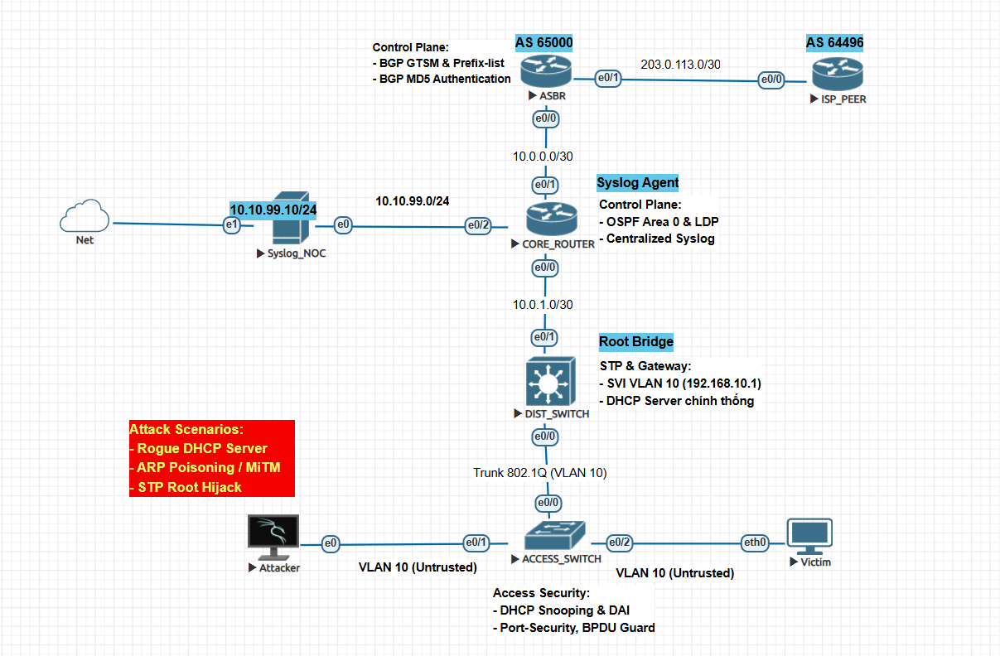

### 2.2. Interface IP Matrix

| Device Name | Interface | IP Address / Mask | Role & Key Protocols |
| :--- | :--- | :--- | :--- |
| **ISP_PEER** | `Ethernet0/0`<br>`Loopback0` | `203.0.113.2/30`<br>`8.8.8.8/32` | Upstream eBGP peer (AS 64496), GTSM, MD5<br>Simulated Internet DNS anchor |
| **ASBR** | `Ethernet0/1`<br>`Ethernet0/0` | `203.0.113.1/30`<br>`10.0.0.1/30` | WAN uplink (`ip nat outside`), eBGP (AS 65000)<br>Core downlink (`ip nat inside`), OSPF Area 0 |
| **CORE_ROUTER** | `Ethernet0/1`<br>`Ethernet0/0`<br>`Ethernet0/2` | `10.0.0.2/30`<br>`10.0.1.1/30`<br>`10.10.99.1/24` | ASBR uplink, OSPF Area 0, MPLS LDP<br>Distribution downlink, OSPF Area 0<br>NOC management subnet gateway |
| **DIST_SWITCH** | `Ethernet0/1`<br>`Vlan10`<br>`Ethernet0/0` | `10.0.1.2/30`<br>`192.168.10.1/24`<br>`Trunk (VLAN 10)` | Routed L3 uplink to core, OSPF Area 0<br>VLAN 10 default gateway, DHCP server<br>802.1Q downlink trunk to the access switch |
| **ACCESS_SWITCH** | `Ethernet0/0`<br>`Ethernet0/1-2`<br>`Vlan10` | `802.1Q Trunk`<br>`Access VLAN 10`<br>`192.168.10.2/24` | Trusted uplink (DHCP Snooping and DAI trust)<br>Hardened edge ports (PortFast, BPDU Guard, Port-Security)<br>In-band management SVI that reports to the syslog server |
| **Syslog_NOC** | `ens3 / eth0` | `10.10.99.10/24` | Centralized syslog and security telemetry collector |
| **Victim (VPCS)** | `eth0` | `192.168.10.11/24` | Client workstation (DHCP assigned) |
| **Attacker (Kali)** | `eth0` | `192.168.10.x/24` | Penetration-testing node (Yersinia, dnsmasq, Scapy) |

> The lab uses documentation ranges (`203.0.113.0/24`, AS 64496) and a private ASN (65000) because it is not connected to the real Internet.
>
> Device configurations are in the `configs/` folder (secrets removed).

---

## ⚔️ 3. Adversary Emulation & Access Layer Defense (Red Team vs. Blue Team)

The access-layer controls below were tested on `ACCESS_SWITCH`. The reference configurations use the interface names and VLAN from the addressing plan and should be read as a summary, not a full config dump.

### Scenario 3.1: Spanning Tree (STP) attack and BPDU Guard containment

**Threat.** An attacker plugs a Kali Linux machine into an edge port and uses `yersinia` to send forged STP configuration and topology-change (TCN) BPDUs. The goal is to disturb the spanning tree, for example by taking over the Root Bridge role, which can cause switching loops or let the attacker see traffic that should not pass through them.

**Defense.** Edge ports run **PortFast** with **BPDU Guard**. A PortFast port faces an end host and should never receive a BPDU, so receiving one is treated as a fault or an attack and the port is shut down immediately.

```text
interface range Ethernet0/1 - 2
 spanning-tree portfast
 spanning-tree bpduguard enable
```

**Evidence**

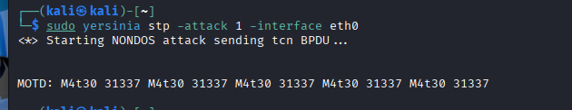

*Figure 1: Red Team: forged TCN BPDUs sent with Yersinia from `eth0` on the Kali node.*

The screenshot shows the attack from the attacker's side: Yersinia in STP mode, sending BPDUs out of the interface that connects to the access switch. Without BPDU Guard, the switch would process these frames as if they came from another switch.

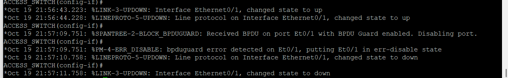

*Figure 2: Blue Team: `ACCESS_SWITCH` logs `%SPANTREE-2-BLOCK_BPDUGUARD` and puts `Et0/1` into `err-disable`.*

The switch reacts to the first unauthorized BPDU. Only the port that received it is shut down, so the rest of the network keeps working and the spanning tree is not touched. The port stays down until an administrator runs `shutdown` / `no shutdown`, or until `errdisable recovery` is configured for BPDU Guard.

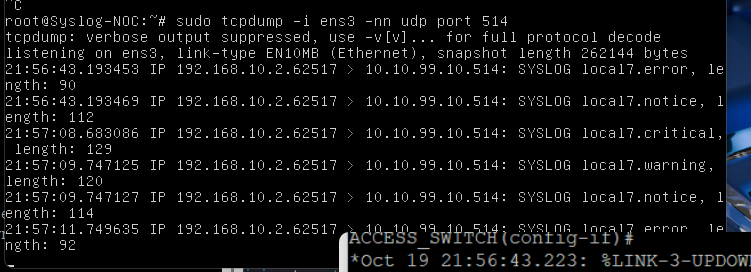

*Figure 3: NOC: the same event arrives at the syslog server as a `local7.critical` message over UDP 514.*

This is the operations side of the same event. The alert reaches the central server with a critical severity, so the NOC sees the problem without logging in to the switch.

---

### Scenario 3.2: MAC spoofing and Port-Security sticky enforcement

**Threat.** An attacker changes the MAC address of their network interface, or connects an extra device or switch to a wall port, to get around access policies or to flood the CAM table with many source addresses.

**Defense.** **Port-Security** allows only **one** MAC address per access port. The first valid MAC is learned and stored with **sticky learning**, and any other source MAC triggers the `shutdown` violation action.

```text
interface Ethernet0/1
 switchport mode access
 switchport access vlan 10
 switchport port-security
 switchport port-security maximum 1
 switchport port-security mac-address sticky
 switchport port-security violation shutdown
```

**Evidence**

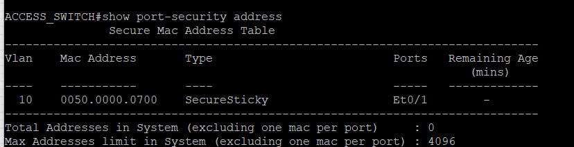

*Figure 4: baseline: the MAC `0050.0000.0700` is learned on `Et0/1` and stored as `SecureSticky`.*

Before the attack, the port has learned one address and recorded it as sticky. The sticky entry is written to the running configuration, so it must be saved to survive a reload.

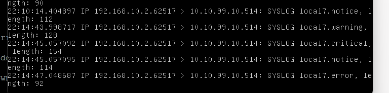

*Figure 5: containment: a frame with the spoofed source MAC `0011.2233.4455` shuts the port (`err-disabled`, `psecure-violation`).*

The spoofed frame is a second source address on a port limited to one, so the violation action fires and the port goes into `err-disable`. `shutdown` is the strictest violation mode: it stops the port completely, whereas `restrict` or `protect` would only drop the offending frames.

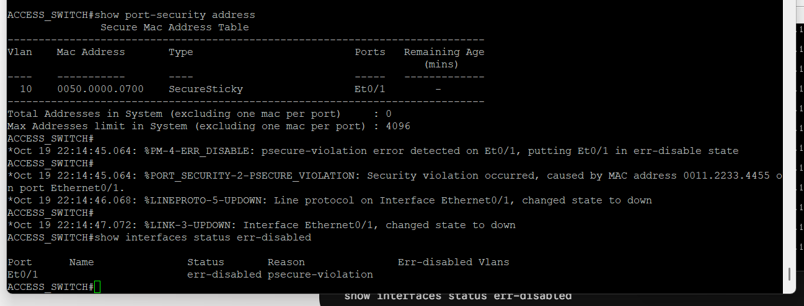

*Figure 6: NOC: the violation is logged centrally together with the offending MAC address.*

The alert includes the address that caused the violation, which gives the NOC the evidence needed to find the device.

---

### Scenario 3.3: Rogue DHCP server and DHCP Snooping

**Threat.** The attacker starts a rogue DHCP service (`dnsmasq`) on the access subnet and races the legitimate server. If a client accepts the rogue offer, it receives an attacker-controlled default gateway and DNS server (`192.168.10.254`), so its outbound traffic can be intercepted.

**Defense.** **DHCP Snooping** is enabled on VLAN 10. Only the uplink toward `DIST_SWITCH` (`Et0/0`) is **trusted**. User-facing ports are **untrusted**, so DHCP server messages (`DHCPOFFER`, `DHCPACK`) arriving on them are dropped.

```text
ip dhcp snooping
ip dhcp snooping vlan 10
interface Ethernet0/0
 ip dhcp snooping trust
```

**Evidence**

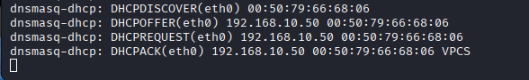

*Figure 7: unprotected state: Kali leases the rogue address `192.168.10.50` to the victim.*

This is the baseline without the protection. The rogue server answers the client first and hands out its own network settings.

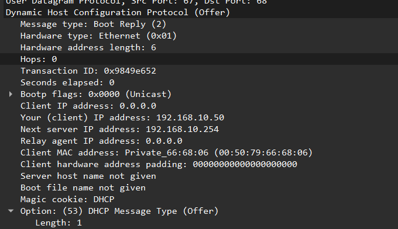

*Figure 8: Wireshark: the rogue `DHCP Offer` comes from `192.168.10.254`, not from the real server.*

The packet capture confirms the source of the offer. Comparing the server address in the offer with the legitimate gateway (`192.168.10.1`) is how a rogue server is recognized.

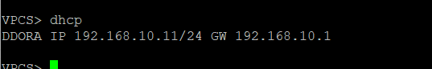

*Figure 9: protected state: the victim completes DORA with the legitimate server and gets `192.168.10.11` and gateway `192.168.10.1`.*

With snooping active, the rogue offers are dropped at the untrusted port and the client only sees the legitimate server.

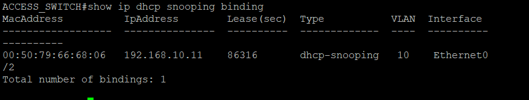

*Figure 10: the switch builds a binding table that maps MAC address, IP address, lease time, VLAN and interface.*

The table is learned dynamically from legitimate DHCP exchanges. It is also the data source that Dynamic ARP Inspection uses in the next scenario.

---

### Scenario 3.4: ARP poisoning (MITM) and Dynamic ARP Inspection (DAI)

**Threat.** The attacker sends forged (gratuitous or unsolicited) ARP replies that tell the victim "the gateway `192.168.10.1` is at my MAC address" (`00:50:00:00:07:00`). The victim sends gateway-bound traffic to the attacker, who can read it and forward it on, a man-in-the-middle (MITM) position.

**Defense.** **DAI** is enabled on VLAN 10. The switch checks ARP packets on untrusted ports against the DHCP Snooping binding table and drops those that do not match. Header validation (`src-mac`, `dst-mac`, `ip`) also rejects malformed ARP packets.

```text
ip arp inspection vlan 10
ip arp inspection validate src-mac dst-mac ip
interface Ethernet0/0
 ip arp inspection trust
```

**Evidence**

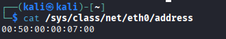

*Figure 11: the MAC address of the attacking node, `00:50:00:00:07:00`.*

This fixes the reference value used in the following screenshots: any ARP entry that contains this MAC for the gateway IP is poisoned.

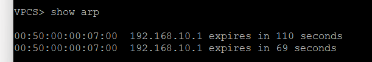

*Figure 12: unprotected state: the victim's ARP table maps the gateway `192.168.10.1` to the attacker's MAC.*

The poisoning worked: the victim now sends traffic meant for the gateway to the attacker's interface.

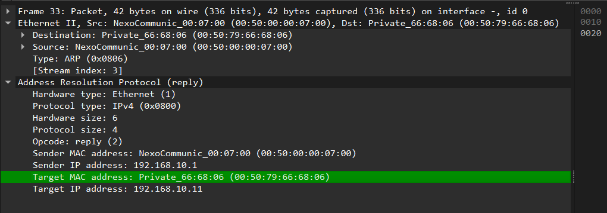

*Figure 13: Wireshark: forged `ARP Reply` (opcode 2) packets in the broadcast domain.*

The capture shows the unsolicited replies that cause the poisoning. The sender IP is the gateway's, but the sender MAC belongs to the attacker.

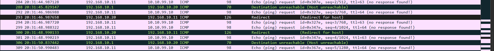

*Figure 14: the victim's traffic to the NOC subnet (`10.10.99.10`) passes through the attacker, which also triggers ICMP redirects.*

This shows the impact of the attack: traffic between the victim and the NOC subnet is visible on the attacker's machine. The ICMP redirects appear because the attacker has to forward packets out of the same interface they arrived on.

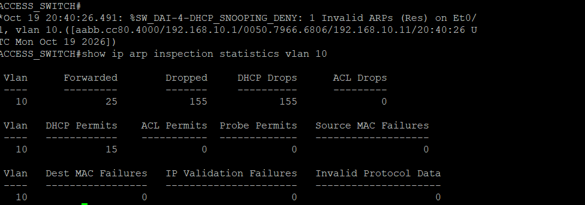

*Figure 15: Blue Team: DAI drops 155 spoofed ARP frames and logs `%SW_DAI-4-DHCP_SNOOPING_DENY`.*

The forged ARP replies do not match any entry in the snooping binding table, so DAI discards them and logs each denial. The counter in the log shows how many frames were dropped.

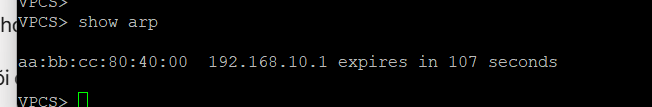

*Figure 16: recovery: the gateway `192.168.10.1` resolves again to the real MAC of `DIST_SWITCH` (`aa:bb:cc:80:40:00`).*

Once the forged replies are blocked, the victim's ARP entry returns to the legitimate gateway MAC and normal forwarding resumes.

---

# 4. WAN Edge & Core Infrastructure Hardening

## 4.1. Edge BGP peering security (`ASBR` ↔ `ISP_PEER`)

The border router is the point where external parties can send traffic at the network, so the eBGP session is protected in three ways:

1. **TCP MD5 signature (RFC 2385):** each TCP segment of the BGP session carries a keyed hash on port 179 (the shared key is not published in this document). Segments from a peer without the key fail validation and are dropped; the router logs this as `%TCP-6-BADAUTH`. MD5 is an older mechanism, and TCP-AO is its modern replacement.
2. **GTSM (RFC 5082):** configured with `neighbor 203.0.113.2 ttl-security hops 1`. Legitimate BGP packets from a directly connected peer are sent with TTL 255, and the router accepts only packets with TTL of 254 or higher. Packets forged by a host that is more than one hop away arrive with a lower TTL and are dropped.
3. **Prefix-list policy:**
   - **Inbound (`IN_FROM_ISP`):** only the default route (`0.0.0.0/0`) and the test address `8.8.8.8/32` are accepted. Bogons and unintended transit prefixes are rejected.
   - **Outbound (`OUT_TO_ISP`):** only the owned public allocation (`203.0.113.0/30`) is advertised. This stops RFC 1918 prefixes from leaking and stops the router from acting as transit.

**Evidence**

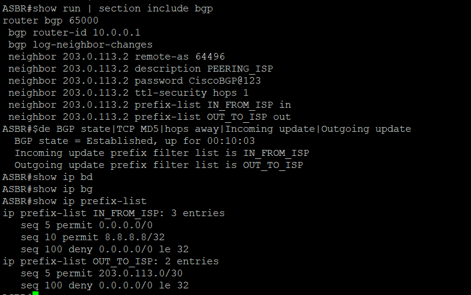

*Figure 16b: eBGP hardening on `ASBR`: neighbor configuration, session state and the two prefix-lists (the MD5 key is blacked out).*

- **Neighbor configuration:** the `router bgp 65000` section shows all three controls on the single peer `203.0.113.2` (AS 64496): the MD5 `password`, `ttl-security hops 1`, and the prefix-lists `IN_FROM_ISP` (in) and `OUT_TO_ISP` (out).
- **Session state:** the neighbor is `Established` (up for 00:10:03), and the output confirms that both prefix filters are attached to the session. The protections therefore do not stop the legitimate peer from coming up.
- **Prefix-lists:** `IN_FROM_ISP` permits only `0.0.0.0/0` and `8.8.8.8/32`, and `OUT_TO_ISP` permits only `203.0.113.0/30`. Each ends with an explicit `deny 0.0.0.0/0 le 32`, so every other prefix is rejected in that direction.

This screenshot proves that the controls are configured and that the session works with them. It does not yet show them blocking anything. A negative test is listed in section 6.

> In this lab the "owned allocation" is the `/30` peering subnet itself, which is a simplification. A real deployment would advertise the public block assigned to the enterprise.

## 4.2. Internal transit (OSPF Area 0, MPLS LDP and NAT overload)

- **OSPF Area 0:** `ASBR`, `CORE_ROUTER` and `DIST_SWITCH` form the interior routing fabric. `ASBR` injects a default route toward the inside with `default-information originate always`.
- **MPLS LDP:** `mpls ip` is enabled on the core transit links with a label range of 100–199, so LDP label forwarding can be observed on the core. No VPN service is built on it in this lab.
- **NAT overload (PAT):** `ASBR` translates the internal subnets (`192.168.10.0/24`, `10.10.99.0/24`, `10.0.0.0/16`) to the address of its WAN interface (`interface Ethernet0/1 overload`), giving them outbound Internet access.

## 4.3. Technical evidence and verification

The screenshots below come from the monitoring tools and network devices used during testing.

**NetFlow Setup Overview:** NetFlow v9 is configured on the `CORE_ROUTER` with ingress/egress flow export enabled on all primary interfaces (Ethernet0/0, 0/1, and 0/2). The flow data is transmitted to the `Syslog-NOC` server (10.10.99.10) over UDP port 2055, where it is collected, rotated, and analyzed using the `nfcapd` and `nfdump` toolset.

### Traffic visibility with NetFlow (`CORE_ROUTER`)

NetFlow summarizes traffic as *flows* (source and destination address, protocol, ports, packet and byte counts). That is enough to see who is talking, how much, and on which ports, without capturing packets.


*Figure 17: test traffic: ICMP echo requests generated from the Kali node.*

This is the traffic that produces the first flow records. A small, known stream makes it easy to find in the flow data.


*Figure 18: the flow cache on `CORE_ROUTER` listing the test traffic as flows.*

The ping traffic appears as flow entries, which confirms that NetFlow is collecting data on the core router.


*Figures 19 and 20: an ICMP flood as seen in NetFlow data.*

During a flood, the flow from the attacking host stands out by its packet and byte counts compared with normal traffic. This is how bandwidth saturation shows up in NetFlow, even when the packets themselves are not captured.


*Figure 21: top talkers by IP address and bytes.*

Ranking hosts by bytes is the quickest way to find the source of unusual load. The flood source should be at the top of this list.


*Figure 22: threat hunting: reverse-shell style traffic on TCP port 4444.*

Flow records include destination ports, so unusual ports can be searched for directly. TCP 4444 is a well-known default for reverse shells, which makes it a useful example of a command-and-control indicator in flow data.

### Log integrity and alert review


*Figure 23: log file protection with `chattr +a`.*

The `a` attribute makes the syslog file append-only: new lines can be added, but existing entries cannot be edited or truncated unless the attribute is removed first (which requires root). This protects the evidence from accidental or casual tampering.


*Figure 24: routing and interface events from the core devices collected by the syslog server.*


*Figure 25: security alerts collected centrally: Port-Security events and BGP session flaps.*

Together, these two screenshots show that infrastructure events and security events both end up in one place, which is what the NOC would review.
---

# 5. Resume & CV Highlights

*Short bullet points for a Projects / Technical Experience section:*

* **Built** a multi-tier enterprise-style network (Access, Distribution, Core, WAN Edge) on Cisco IOS/IOL in EVE-NG with OSPF Area 0, MPLS LDP and NAT overload.
* **Tested and mitigated** four Layer 2 attacks launched from a Kali host (STP manipulation, MAC spoofing, rogue DHCP server, ARP poisoning) using BPDU Guard, Port-Security sticky, DHCP Snooping and Dynamic ARP Inspection, with before/after evidence for each.
* **Hardened** the eBGP edge with RFC 2385 TCP MD5, RFC 5082 GTSM and inbound/outbound prefix-lists to limit session hijacking and unwanted route advertisement.
* **Set up** centralized logging (`rsyslog` over UDP 514) and NetFlow analysis (top talkers, ICMP flood, port 4444 traffic) so that security events and traffic anomalies could be reviewed in one place.

---

# 6. Limitations & Future Work

- **Single path:** one upstream ISP and one path through the network, so there is no redundancy and no failover test.
- **Syslog transport:** UDP 514 is unreliable and unauthenticated. TCP or TLS syslog would be more suitable outside a lab.
- **BGP:** MD5 is a legacy mechanism (TCP-AO is the modern option), and the outbound prefix-list advertises the peering `/30` rather than a real public block.
- **Scope of L2 controls:** DHCP Snooping and DAI cover VLAN 10 only. Hosts with static IP addresses would need ARP ACLs, because DAI relies on the snooping binding table.
- **Detection only for flow data:** NetFlow shows the flood and the port 4444 traffic, but no automated response is attached to those findings.
- **BGP negative test:** the BGP controls are shown as configuration with a working session (Figure 16b). Still to add: `advertised-routes` output, and a test where a peer with a wrong MD5 key or a multi-hop source is rejected (the `%TCP-6-BADAUTH` log).
- **Next steps:** 802.1X or additional port controls, rate limiting on DHCP and ARP, and alerting on NetFlow anomalies.
